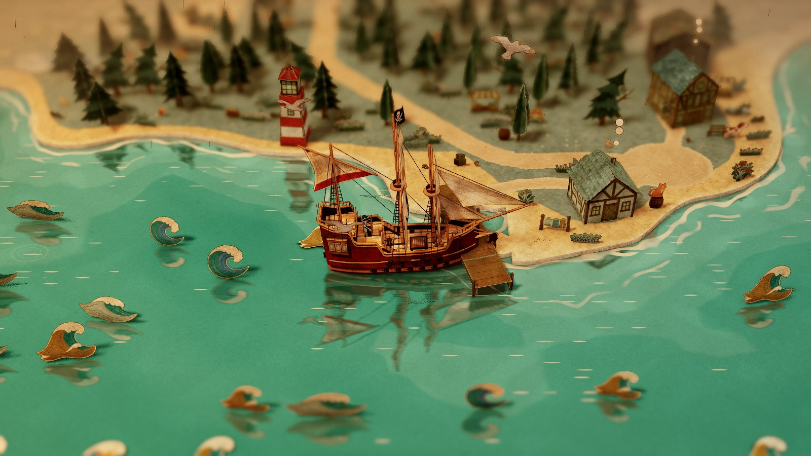
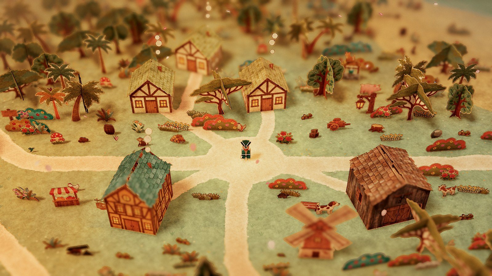
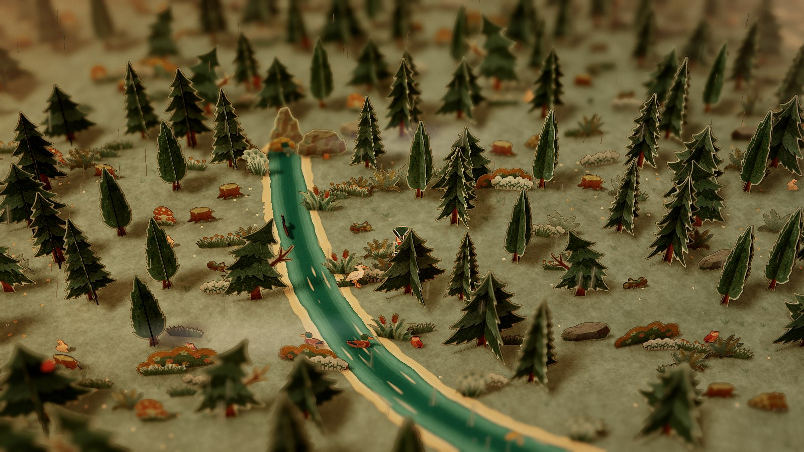
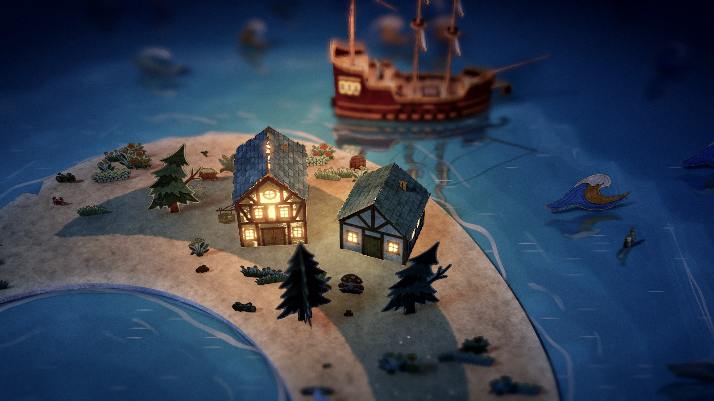
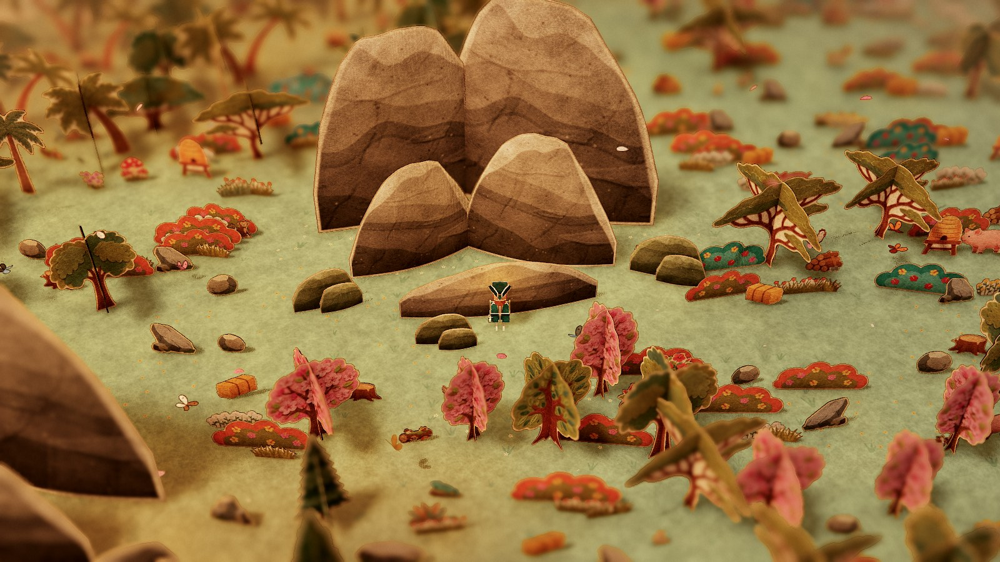
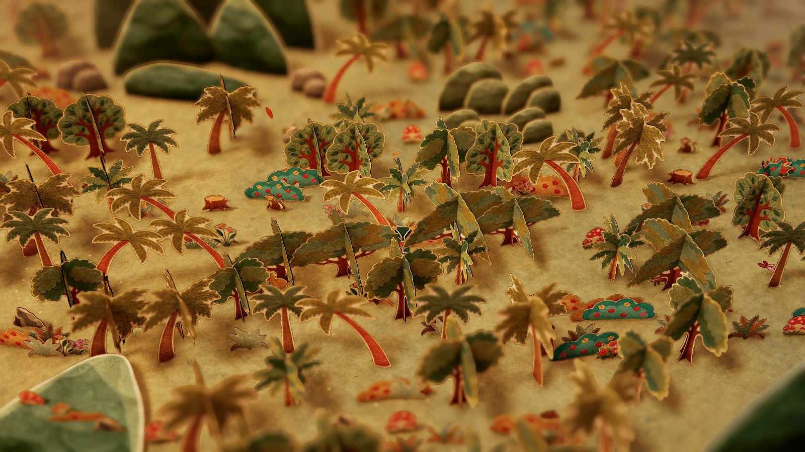
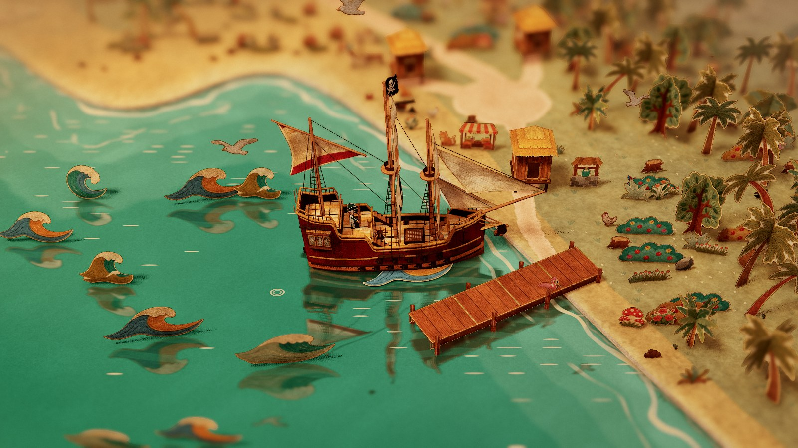
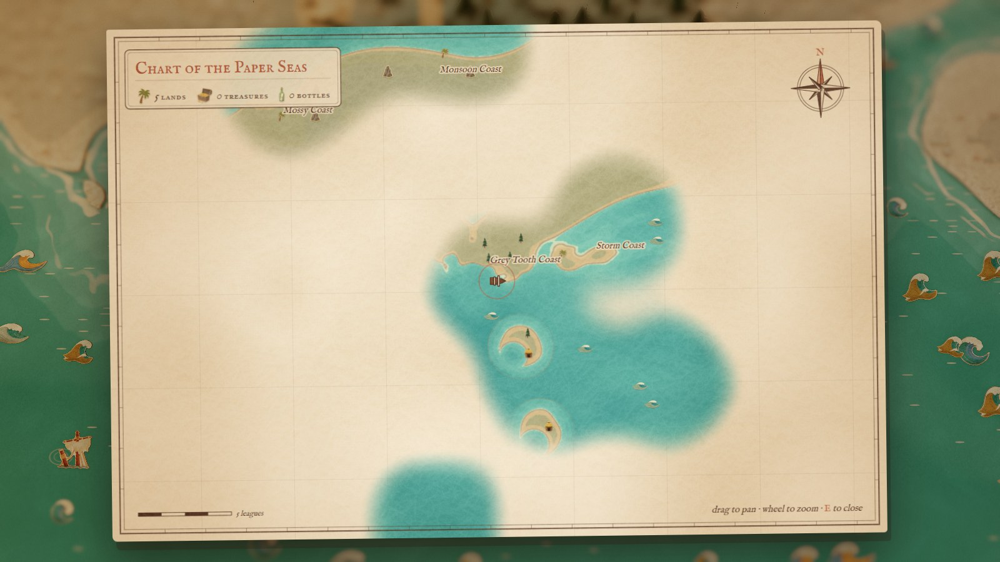
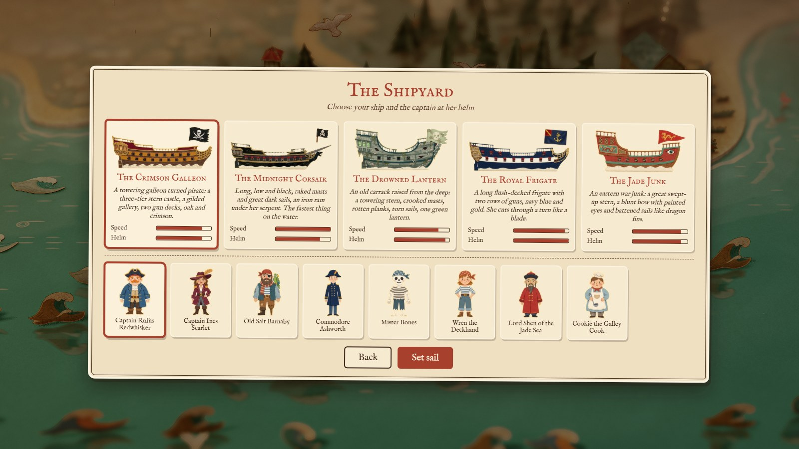

<h1 align="center">Paper Seas</h1>

<p align="center">
  <em>Sail a paper pirate ship across an endless pop-up ocean.</em>
</p>

<p align="center">
  <a href="https://paper-seas.felipolis.workers.dev"><strong>⛵ Play it in your browser</strong></a>
</p>

<p align="center">
  <a href="https://github.com/felipolis/paper-seas/actions/workflows/deploy.yml"></a>
  <a href="LICENSE"></a>
  
  
</p>

<p align="center">
  
</p>

The whole world is a pop-up book. Islands, villages, forests and the waves themselves fold up out of the page as your
ship draws near and lie down flat again in its wake, every piece a die-cut card of felt and paper with a cream cut edge.
The sea goes on forever and no two voyages are the same: each one is drawn from a seed, so a place you sail back to is
still there, just as you left it.

Go ashore and walk the captain through markets and pine woods, along streams with ducks and herons, past hens, goats
and sleeping cats. Chart the coasts you find, hunt for treasure chests on the beaches, read the bottles the tide brings in, and watch the
lanterns come on in the windows when night falls.

## A look around

<table>
  <tr>
    <td width="50%"></td>
    <td width="50%"></td>
  </tr>
  <tr>
    <td><b>Villages</b> fold up with their lanes, wells, stalls, windmills and animals, each one laid out by the seed.</td>
    <td><b>Streams</b> rise at a spring and run down to the sea, through woods that change colour with the biome.</td>
  </tr>
  <tr>
    <td></td>
    <td></td>
  </tr>
  <tr>
    <td><b>Day turns to night</b> on its own clock, and every window and lantern lights up.</td>
    <td><b>Meadows</b> in blossom, with rocks to walk round and animals that wander off when you come close.</td>
  </tr>
  <tr>
    <td></td>
    <td></td>
  </tr>
  <tr>
    <td><b>Jungles</b> thick with palms and broadleaf trees, home to monkeys, parrots and toucans.</td>
    <td><b>Ports</b> with piers you can walk out along, and step ashore from the ship onto.</td>
  </tr>
  <tr>
    <td></td>
    <td></td>
  </tr>
  <tr>
    <td><b>The chart</b> fills in as you explore, naming every coast you discover.</td>
    <td><b>The shipyard</b>: five ships, each with her own build and handling, and eight captains.</td>
  </tr>
</table>

## Features

- **An endless, seeded ocean**: open sea most of all, with islands, archipelagos, villages, ports, ruins and wild
  interiors, all a pure function of the seed.
- **Everything pops up**: cards, buildings, mountains, piers and bridges unfold on paper springs as you approach, and
  what lies folded far away fades into a pencil sketch of the book.
- **Five biomes**: jungle, pine woods, blossom meadows, rocky heights and beaches, each with its own trees, ground cover,
  colours, streams and animals.
- **A ship with weight**: inertia, sails set by steps, a heel into the turn; five ships that each handle differently.
- **Go ashore**: walk the captain along roads and lanes, onto piers and over bridges; the animals react to you.
- **Life everywhere**: whales, dolphins, turtles, sharks and the odd kraken at sea; gulls, flocks, butterflies,
  fireflies, falling leaves, rain and mist on land.
- **A day and night cycle** with lit windows and lanterns, and a synthesised felt-piano score with paper sounds.

## Controls

| Key | Action |
| --- | --- |
| W / S | Raise / lower sails (furled → courses → all sails) |
| A / D | Helm (port / starboard) |
| S with sails furled | Back-paddle |
| F | Go ashore by a coast or onto a pier (walk with WASD, Shift to run); F again by the ship to go back aboard |
| E / Tab | Voyage chart (drag to pan, wheel to zoom) |
| Mouse wheel | Zoom |
| T (hold) | Fast-forward the clock |
| M | Mute / unmute |
| Esc | Pause menu, shipyard and a new voyage |

Sail close to an island to discover it, and nose the bow onto a beach that has a chest to find its treasure. Your
progress is kept in your browser.

## Run it locally

Vite + TypeScript + Three.js, no framework. You need Node 22.

```bash
npm install
npm run dev      # http://localhost:5180
npm run build    # typecheck + production build in dist/
```

The art tools (`npm run art:cut` and `tools/`) and the world QA (`node tools/qa/world-qa.mjs 1234,7,42`, against the
running dev server) drive Microsoft Edge headless; the model builds need Blender 5.3. The screenshots above come from
`node tools/media/screenshots.mjs`.

## How it's made

Paper Seas follows the look and the rules of [papertrails](https://github.com/xikhar/papertrails): every sprite is a
die-cut card with a printed cream edge, the buildings, ships and mountains are real hinged paper models built in
Blender, the ground is one flat sheet cut to the shore, and the light, shadows, haze and tilt-shift blur are paper's.

- [How it works](docs/how-it-works.md): the code's layout, every rule taken from papertrails (what stands up and when,
  biomes, collisions, light, life, the camera) and the world QA.
- [The art pipeline](docs/art-pipeline.md): how the cards are generated and cut, and how the buildings, ships,
  captains and mountains are built.

## Deploy

The game is a static site served by Cloudflare Workers (`wrangler.jsonc`: `dist/` as its static assets). The `Deploy`
workflow (`.github/workflows/deploy.yml`) type-checks and builds every pull request, and on every push to `main` also
deploys with `wrangler deploy`. It needs two repository secrets: `CLOUDFLARE_API_TOKEN` (a token made from the "Edit
Cloudflare Workers" template) and `CLOUDFLARE_ACCOUNT_ID`.

## Credits

Inspired by [papertrails](https://github.com/xikhar/papertrails) by xikhar (MIT licence), whose look and rules it
follows. The felt-piano voice and its hall (`src/audio/piano-synth.ts`, `src/audio/music.ts`) and the paper-flap
synthesis and voice allocation (`src/audio/paper-synth.ts`, `src/audio/paper-voices.ts`) are ported from its
`src/audio`, and many of its shaders and tunables are ported throughout (credited where they are used); the music
played on that piano is Paper Seas' own. The printed art was generated with Google Flow and cut into cards by
`tools/art`.

## License

[MIT](LICENSE). The parts ported from papertrails keep its MIT notice, included in the same file.
